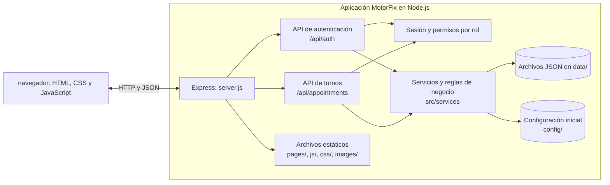
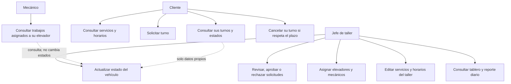
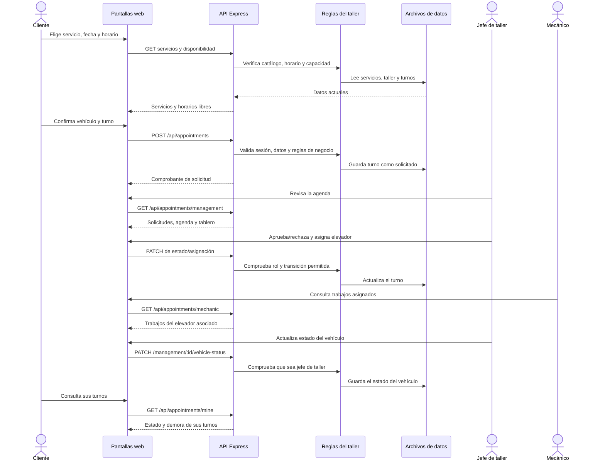
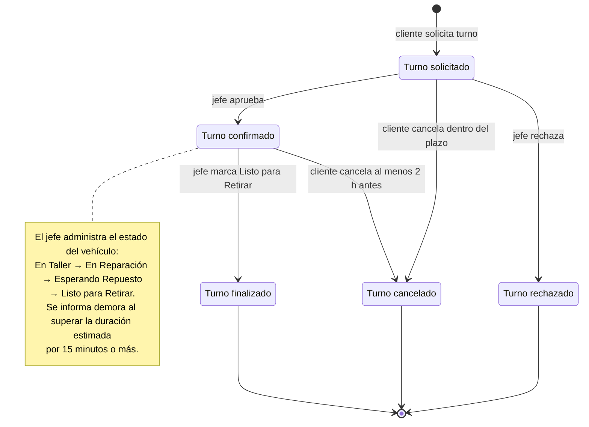

# Diagramas de MotorFix

Estos diagramas describen el funcionamiento implementado actualmente. Se pueden visualizar en GitHub o en un editor compatible con Mermaid.

## 1. Arquitectura actual

## 2. Roles y acciones principales

## 3. Flujo del caso de uso principal: solicitud y reparación

## 4. Estados de un turno y del vehículo

> El estado del turno y el estado del vehículo son distintos; solo el jefe de taller puede modificarlos.
